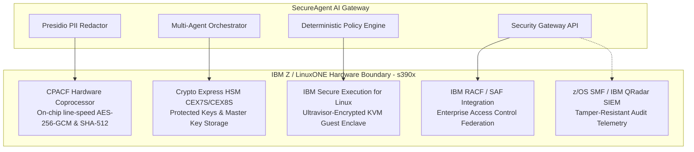

# IBM Z & LinuxONE Integration Guide

**Platform**: Linux on IBM Z / LinuxONE (`s390x`)  
**Target Environment**: Enterprise Mainframe Deployment with Confidential Computing & CPACF Acceleration

---

## 1. Architectural Philosophy: Hardware-Anchored AI Security

SecureAgent AI bridges modern agentic AI architectures with the security engineering practices of IBM Z. Rather than treating the language model as a trusted environment, the system utilizes an outer security boundary backed by platform adapters.

On IBM Z and LinuxONE infrastructure, this outer perimeter leverages hardware-assisted cryptography, confidential computing enclaves, and enterprise identity integration.



---

## 2. Verified Local Capabilities vs. Production IBM Z Deployment

To ensure transparency and reproducible evaluation without requiring physical access to a mainframe, SecureAgent AI operates in two documented modes:

| Security Feature | Local Development Mode (Verified) | Production IBM Z Deployment (`s390x`) |
| :--- | :--- | :--- |
| **Platform Target** | x86_64 / ARM64 workstation (Windows/macOS/Linux). | Linux on IBM z15/z16 or LinuxONE III/IV (`s390x`). |
| **Cryptography** | Standard Python `cryptography` and `hashlib` modules. | Hardware instructions `KM`, `KMC`, `KLMD`, and `KMAC` via CPACF engine. |
| **Confidential Computing** | Process sandboxing and in-memory isolation. | Hardware-enforced VM encryption via IBM Secure Execution (KVM Ultravisor). |
| **Enterprise Identity** | Simulated persona mapping (viewer, analyst, admin). | Federated LDAP bridge to IBM Resource Access Control Facility (RACF). |
| **Audit Storage** | SQLite ledger with SHA-256 hash chaining. | Cryptographically signed stream to z/OS SMF Type 83/119 records or IBM QRadar. |
| **Hardware Status** | Explicitly reported as `LOCAL_EMULATION`. | Explicitly reported as `PRODUCTION_IBM_Z`. |

---

## 3. Core Integration Adapters

### A. CPACF (CP Assist for Cryptographic Functions)
On IBM Z processors, CPACF provides coprocessor instructions integrated directly into each processor core:
- **Symmetric Encryption**: Hardware-accelerated AES-256-GCM.
- **Hashing**: Hardware SHA-256 and SHA-512 calculations without context-switch latency.
- **Adapter Implementation**: The adapter in `backend/app/adapters/ibm_z.py` executes `execute_accelerated_hash()` using OpenSSL `s390x` acceleration when `platform.machine() == "s390x"`, falling back to standard software hashing in local development.

### B. IBM Secure Execution for Linux
IBM Secure Execution provides confidential computing by encrypting the guest VM memory with a key unique to the physical mainframe's Ultravisor:
- **Threat Mitigated**: Prevents host hypervisor administrators, root operators, or malicious host processes from inspecting model weights, conversation context, or in-memory decrypted PII.
- **Verification**: On an s390x guest, the adapter checks `/sys/firmware/uv/prot_virt_guest` to verify that Ultravisor memory protection is active.

### C. IBM RACF Identity Mapping
Federated enterprise authentication maps RACF user IDs to internal authorization roles:
- `RACF-SEC*` / `RACF-ADM*` $\to$ `admin` (can approve high-risk actions, inspect audit integrity)
- `RACF-ANA*` / `RACF-OPS*` $\to$ `analyst` (can query synthetic internal records with masked PII)
- `RACF-VIEW*` / Default $\to$ `viewer` (read-only access to public metrics)

### D. Tamper-Resistant Audit Telemetry
The local SQLite hash-chained ledger provides verifiable tamper-evidence. In production, this ledger streams to IBM QRadar SIEM via RFC 5424 TLS Syslog or IBM z/OS System Management Facility (SMF), satisfying SOC 2 Type II and FIPS 140-3 audit requirements.

---

## 4. Production Deployment on Linux on IBM Z (`s390x`)

### Step 1: Verify Host Architecture
Log into the IBM Z or LinuxONE instance and confirm the architecture:
```bash
uname -m
# Expected output: s390x
```

### Step 2: Install Prerequisites
```bash
sudo dnf install -y python311 python311-devel openssl-devel gcc
```

### Step 3: Clone & Install SecureAgent AI
```bash
git clone https://github.com/example/secureagent-ai.git
cd secureagent-ai
python3.11 -m venv venv
source venv/bin/activate
pip install -r backend/requirements.txt
```

### Step 4: Verify IBM Z Adapter Auto-Detection
```bash
python -c "from app.adapters.ibm_z import ibm_z_adapter; print(ibm_z_adapter.get_platform_posture())"
```
The application will detect `s390x`, automatically enabling the `PRODUCTION_IBM_Z` execution mode and hardware-accelerated cryptographic primitives.
